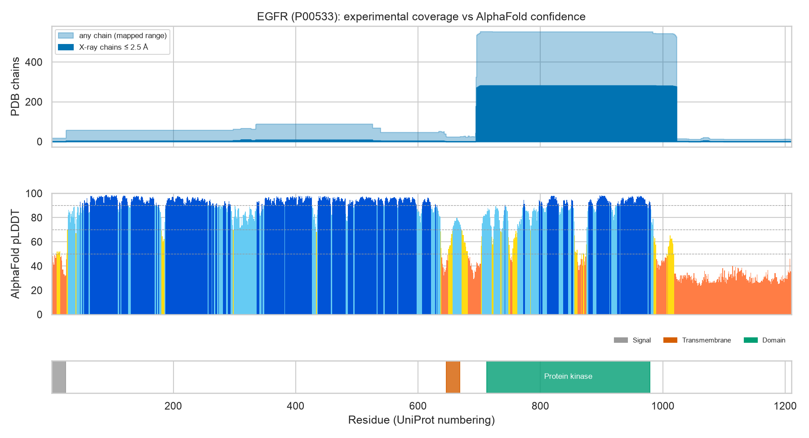

# 01 · My Implementation

| File | What it is |
|------|------------|
| [`RESOURCE_MAP.md`](RESOURCE_MAP.md) | **One-page map** of every data resource used in this repository: a diagram, the kind of each resource (archive vs added value), and links to the notebooks that use it |
| [`01_egfr_cross_reference_walk.ipynb`](01_egfr_cross_reference_walk.ipynb) | **Checks the map's links with code:** starting from UniProt P00533 (EGFR), it follows cross-references to PDBe, AlphaFold DB, ChEMBL, Ensembl and Europe PMC, checks that they agree, and compares experimental structure coverage with AlphaFold confidence along the protein |
| [`FAIR.md`](FAIR.md) | How this repository applies the FAIR principles, what the Tara Oceans audit taught me, and the remaining gaps |
| [`figures/`](figures/) | Figure saved by the notebook |

Related repository-level files added for FAIR: [`CITATION.cff`](../../CITATION.cff) (how to cite this work) and
[`requirements-lock.txt`](../../requirements-lock.txt) (the exact versions every notebook was last run with).

**Run it:** `make lab` → open the notebook with the *Python 3 (EMBL-EBI DS .venv)* kernel → *Run All* (~1 min on the
first run, then cached). ChEMBL and Ensembl had intermittent outages while I wrote this. The client retries with
backoff, so if a cell still fails, re-run it later.
