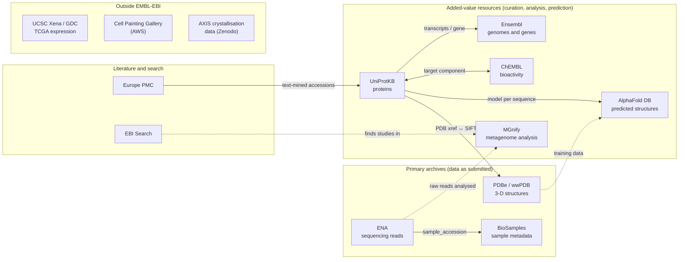
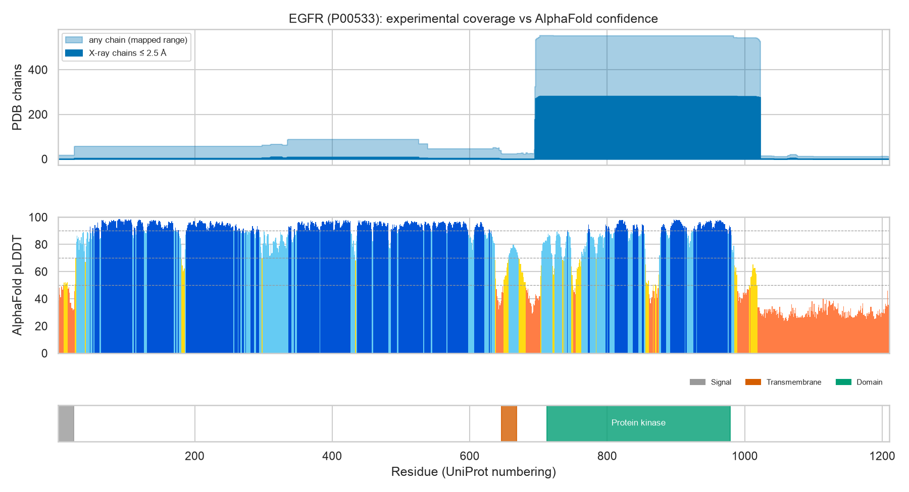

# Map of the data resources used in this repository

Which public resources does this repository use, what kind of resource is each one, and **where exactly** is it used?
Arrows are cross-references between resources. Solid arrows were **checked with code** in
[`01_egfr_cross_reference_walk.ipynb`](01_egfr_cross_reference_walk.ipynb); dashed arrows are links the course relies on
but that I haven't verified.

## Where each resource is used

| Resource | Kind | Used in this repo | How it's accessed |
|----------|------|-------------------|-------------------|
| **UniProtKB** | Curated knowledgebase | [02.1 aquaporin family](../../02_accessing_and_handling_data/01_apis_and_data_collection/implementation/01_uniprot_aquaporin_family.ipynb) · [02.2 sequence EDA](../../02_accessing_and_handling_data/02_handling_and_visualisation/implementation/01_aquaporin_sequence_eda.ipynb) · [01 cross-reference walk](01_egfr_cross_reference_walk.ipynb) | REST search (paginated by `Link` header), `stream` FASTA · [`dsls.uniprot`](../../src/dsls/uniprot.py) |
| **ChEMBL** | Curated bioactivity | [02.1 EGFR inhibitors](../../02_accessing_and_handling_data/01_apis_and_data_collection/implementation/02_chembl_egfr_ic50.ipynb) · 01 walk | REST (`page_meta.next`), year-partitioned for deep queries · [`dsls.chembl`](../../src/dsls/chembl.py) |
| **ENA** | Primary archive | [02.1 Tara Oceans inventory](../../02_accessing_and_handling_data/01_apis_and_data_collection/implementation/03_ena_tara_oceans_runs.ipynb) · course practical (ISS dust study) | Portal API (`search`, `count`, `limit=0` TSV) · [`dsls.ena`](../../src/dsls/ena.py) |
| **BioSamples** | Primary archive (samples) | Tara Oceans sample records (through ENA's `result=sample`) | ENA Portal API by accession |
| **MGnify** | Analysis of metagenomes | [02.1 course practical](../../02_accessing_and_handling_data/01_apis_and_data_collection/) (`curl`/`jq`, MGnipy) | MGnify API (`links.next`) · `dsls.ebi_api.mgnify()` |
| **EBI Search** | Cross-resource search | 02.1 course practical (finding the ISS study) | EBI Search REST |
| **PDBe** | Structure archive + SIFTS mappings | 01 walk · course structural-biology material ([pdbe-api-training](../../COURSE_MATERIALS.md)) | PDBe REST API (`mappings/best_structures`) |
| **AlphaFold DB** | Predicted structures | 01 walk; the lecture's flagship AI example | AlphaFold API + per-residue confidence JSON |
| **Ensembl** | Genome annotation | 01 walk | Ensembl REST (`lookup/id`) |
| **Europe PMC** | Literature | 01 walk | Europe PMC REST (`search`) |
| UCSC Xena / GDC *(external)* | TCGA cancer transcriptomics | [05 gene-expression project](../../05_group_projects/gene_expression/) | Xena hub downloads (course notebook) |
| Cell Painting Gallery *(external)* | Microscopy profiles | [05 bioimaging project](../../05_group_projects/bioimaging/) | AWS S3 via the `aws` CLI |
| AXIS dataset *(external)* | Crystallisation images and diffraction data | [03.2](../../03_foundations_of_machine_learning/02_hyperparameters_and_performance/) · [05 structural biology](../../05_group_projects/structural_biology/) | Tabular data in the course tutorial repo; images (~8 GB) from Zenodo |

## What the cross-reference walk found (EGFR, P00533)

| Link | Result |
|------|--------|
| UniProt ↔ ChEMBL | Reciprocal: P00533 ↔ CHEMBL203 (19,378 IC50 records, analysed in 02.1) |
| UniProt → AlphaFold DB | 4 models (canonical + 3 isoforms); canonical model sequence identical to UniProt |
| UniProt → Ensembl | All 4 linked transcripts exist in the Ensembl gene (chr7, 23 transcripts) |
| UniProt ↔ PDBe | 388 entries shared; 6 recent entries in PDBe only, because the two update on different schedules |
| Europe PMC → UniProt | 638 articles cite P00533 (text-mined, one-way) |

The figure shows how experiment and prediction complement each other: the kinase domain (the drug target) has about
280 high-resolution X-ray chains per residue, the extracellular region has few structures but confident predictions
(pLDDT 91), and the C-terminal tail has neither (pLDDT 32, likely disordered).

## Primary vs added-value: why the distinction mattered in practice
- **Archives keep what was submitted.** This includes mistakes: ENA's Tara Oceans metadata has placeholder ontology
  IDs and dates only in free text. Cleaning is the user's job.
- **Added-value resources curate, so check their filters.** ChEMBL's pChEMBL value already excludes censored and
  flagged measurements, and UniProt's "reviewed" flag selects manually curated entries. Knowing what the curation
  removed is part of using the data correctly.
- **Cross-references are snapshots.** Each resource updates on its own schedule, so linked records can disagree for
  a few weeks after a release (see the PDB comparison above).
