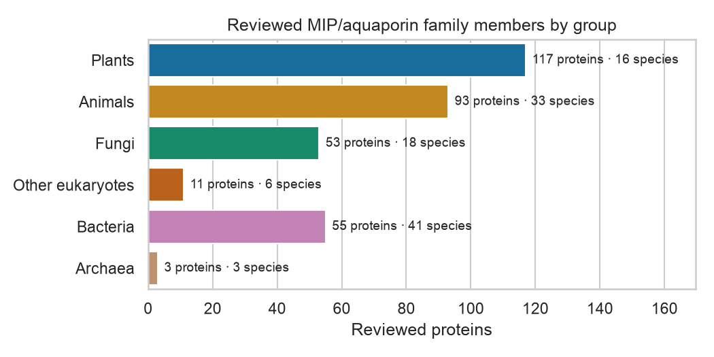
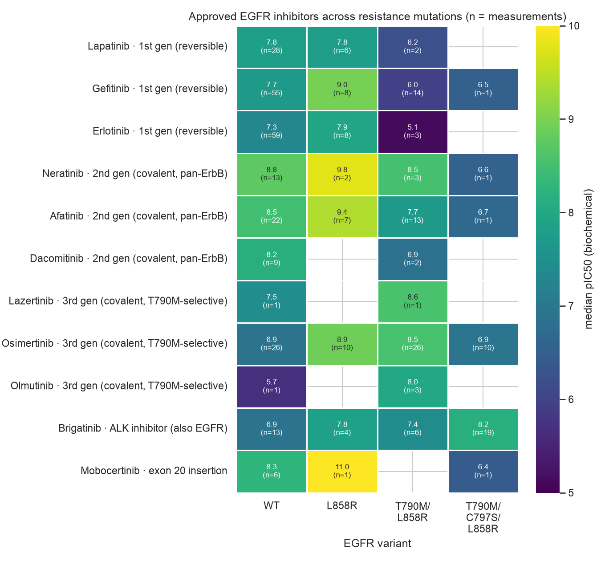
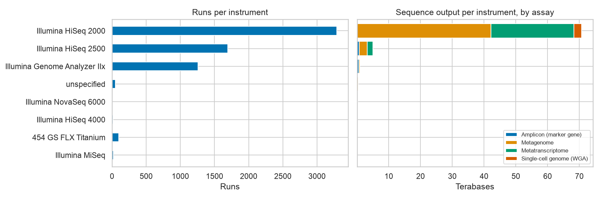

# 02.1 · My Implementation

My own work for [02.1 APIs & Data Collection](../): a reusable API client, and analyses built on it.

| File | What it is |
|------|------------|
| [`01_uniprot_aquaporin_family.ipynb`](01_uniprot_aquaporin_family.ipynb) | **UniProt analysis of the aquaporin water-channel family.** Retrieves all 332 reviewed members via the REST API (4 paginated requests), flattens them into a table, and asks five questions: taxonomic spread, conservation of the family hallmarks (6 helices, 2 NPA motifs), length, structural coverage, subcellular location. Separates data artefacts (fragments, annotation gaps) from real biology (non-canonical NPC/NPG motifs) |
| [`02_chembl_egfr_ic50.ipynb`](02_chembl_egfr_ic50.ipynb) | **ChEMBL analysis of EGFR inhibitors.** Retrieves all 19,378 EGFR IC50 values with a pChEMBL value (year-partitioned so it survives API failures), removes duplicates through an explicit, counted funnel, and asks: how potent are published inhibitors, how reproducible is an IC50, do approved drugs show the expected resistance pattern on T790M/C797S mutants, which compounds are mutant-selective, and how has the field shifted over time |
| [`03_ena_tara_oceans_runs.ipynb`](03_ena_tara_oceans_runs.ipynb) | **ENA inventory of the Tara Oceans project (PRJEB402).** Lists all 6,423 runs across 22 sub-studies and summarises assays, instruments, read counts and release timeline. Recovers collection date, station, depth layer and size fraction from free-text sample descriptions, and audits metadata completeness (FAIR) |
| [`figures/`](figures/) | Figures saved by the notebooks |
| [`../../../src/dsls/ebi_api.py`](../../../src/dsls/ebi_api.py) | **Reusable EMBL-EBI API client** (used by this and later modules): retries with backoff and `Retry-After`, pagination strategies for UniProt / ChEMBL / MGnify, an on-disk cache with provenance (URL, time, data release) |
| [`../../../src/dsls/uniprot.py`](../../../src/dsls/uniprot.py) | Flattens UniProtKB JSON entries into analysis-ready records |
| [`../../../src/dsls/chembl.py`](../../../src/dsls/chembl.py) | ChEMBL curation: counted filter funnel, variant normalisation (`"L858R,T790M"` → `T790M/L858R`), per-compound medians |
| [`../../../src/dsls/ena.py`](../../../src/dsls/ena.py) | ENA Portal helpers: run table with a `/count` integrity check, batched sample lookup, assay labels, placeholder-ontology detection, completeness audit |
| [`../../../tests/`](../../../tests/) | 51 offline unit tests (fake HTTP clients, synthetic records) + 1 live smoke test; run in CI on every push |

## Key results: UniProt aquaporins (release 2026_04)



- **83 %** of the 332 proteins carry both hallmarks (87 % of complete sequences). All 14 fragments lack one,
  simply because they're incomplete.
- **Genuine exceptions:** AQP11 has an **NPC** motif (4 mammals), and microsporidian aquaporins have **NPG** (5 proteins).
- **Structures are scarce and skewed:** 23 proteins (7 %) have PDB entries, mostly from animals. Plants have the most
  proteins (117) but only 3 with structures.
- **Compartments by lineage:** vacuole membrane only in plants, basolateral/vesicle membranes only in animals.

## Key results: ChEMBL EGFR inhibitors (release ChEMBL_37)



- **Resistance is visible in the data.** First-generation gefitinib loses ≈ 50× potency on T790M/L858R (n = 14).
  Osimertinib is ≈ 40× *more* potent on that mutant than on wild type (n = 26 each), and adding C797S takes that
  advantage away.
- **An IC50 is a ±4-fold number:** the median spread across independent assays of the same compound is 0.63 log units.
  Isolated-enzyme values are ≈ 3× more potent than cell-based ones.
- **10.9 % of records are re-reported duplicates**, and a single high-throughput dataset makes up 43 % of 2021, which
  would mislead a naive trend plot.
- **Limits of ChEMBL's data model:** exon 20 insertions are filed as "UNDEFINED MUTATION", and mutant cell-line assays
  aren't linked to the EGFR target.

Full reasoning, including caveats on small n, is in each notebook's *Findings* section.

## Key results: ENA Tara Oceans (retrieved 2026-11-07)



- **6,423 runs, 1,940 samples, 149 stations, 77.4 Tbp.** Amplicon runs are 44 % of the runs but 2 % of the bases, and
  the HiSeq 2000 produced 91 % of all bases.
- **Median reads per run differ about 100× by assay** (amplicon 1.6 M vs metagenome 164 M). 57 runs have < 100k reads.
- **Released over 12 years (2013–2025):** the median delay from sampling to release is 5–7.5 years, depending on assay.
- **Metadata audit:**
  - Collection date and country are empty in 100 % of structured fields. They exist only in prose, and I parsed 88–92 % of them.
  - 82 % of runs carry a placeholder `ENVO:xxxxxxxx` material term.
  - Size fractions are spelled 22 different ways.
  - Searching samples by project finds only 448 of the 1,940 samples.

## Engineering notes
- **Testing caught what it should, and the live data caught what the tests missed.** The first version split UniProt's
  `Link` header on commas, but UniProt's next-page URLs contain commas (`fields=accession,length,…`). The fake-data tests
  passed; the first real 4-page query returned HTTP 404 on page 2. It's fixed with a regex parser, plus a regression test
  using a realistic URL.
- **Designing for an unreliable API:** ChEMBL returned HTTP 500 for offsets past 10,000, then had a full outage. The
  download is split into publication-year slices (each < 10k records), waits for `status.json` to recover, and caches
  every page, so it resumes rather than restarting.
- **Checking the data, not just the code:** reading the first results showed `UNDEFINED MUTATION` being parsed as a
  variant called "MUTATION/UNDEFINED", and dacomitinib missing because ChEMBL names the parent "DACOMITINIB
  ANHYDROUS". Both are fixed, and the first has a test.
- **Assertions as guards:** the notebook asserts that the number of entries retrieved equals UniProt's
  `X-Total-Results`, so a pagination bug can't silently produce a smaller dataset.

## Run it
```bash
make setup      # installs the dsls package (editable) and test tools
make test       # 51 offline tests
make lab        # open this notebook with the "Python 3 (EMBL-EBI DS .venv)" kernel → Run All
```
The UniProt notebook's first run calls the API (~5 s). The ChEMBL notebook's first run downloads ~19k records (~30 min,
because ChEMBL is slow); later runs take ~10 s from the cache. The ENA notebook needs ~30 s on its first run. Later runs read the cache in `data/raw/api_cache/uniprot/` and are offline and
reproducible. Delete that folder to fetch a newer UniProt release.

*ENA data: freely available ([ENA policies](https://www.ebi.ac.uk/ena/browser/about/policies)); Tara Oceans: Sunagawa et al., Science 348 (2015); Pesant et al., Sci. Data 2, 150023 (2015).*
*ChEMBL data: [CC BY-SA 3.0](https://chembl.gitbook.io/chembl-interface-documentation/about#data-licensing). Zdrazil et al., The ChEMBL Database in 2023, Nucleic Acids Res. 52, D1180 (2024).*
*UniProt data: [CC BY 4.0](https://www.uniprot.org/help/license). The UniProt Consortium, UniProt: the Universal Protein Knowledgebase.*
