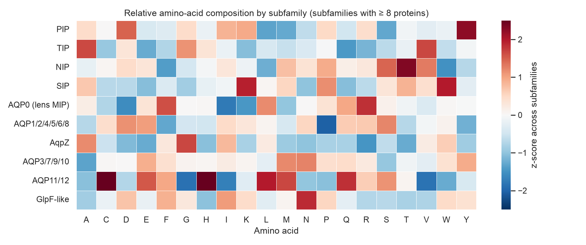

# 02.2 · My Implementation

My own work for [02.2 Handling & Visualisation](../): a tested sequence utility and an exploratory analysis that
uses it.

| File | What it is |
|------|------------|
| [`01_aquaporin_sequence_eda.ipynb`](01_aquaporin_sequence_eda.ipynb) | **EDA of the 332 reviewed aquaporins (data from 02.1 + their sequences).** Cleans 150 inconsistent protein names into lineage-aware subfamilies, engineers sequence features, reshapes with `melt`/`groupby`/`pivot_table`, and builds a figure set (composition heatmap, distributions, correlations, water-vs-glycerol comparison, k-mer PCA), each with an interpretation |
| [`figures/`](figures/) | Figures saved by the notebook |
| [`../../../src/dsls/seq.py`](../../../src/dsls/seq.py) | **FASTA/k-mer utility** (PyLab Tier 5 skills): generator-based FASTA parser (multi-line, CRLF, blank lines, UniProt IDs), overlapping k-mers with alphabet filtering, composition, Kyte–Doolittle GRAVY, overlapping regex motif search |
| [`../../../tests/test_seq.py`](../../../tests/test_seq.py) | 9 unit tests for the utility (edge cases included) |

## Key results (UniProt release 2026_04)



- **Pore geometry is fixed while length varies:** the distance between the two NPA motifs is constant within each
  subfamily (e.g. PIP 121 ± 0.2 residues), whereas lengths range from 231 to 295 aa (subfamily medians).
- **Aquaglyceroporins have ~16 more residues between their pore motifs** than water-selective channels (132 vs 116;
  rank-biserial r = 0.62). That is the clearest of six feature comparisons.
- **Longer aquaporins are less hydrophobic** (length vs GRAVY, ρ = −0.86), which fits a constant hydrophobic core with
  variable charged regions.
- **Alignment-free dipeptide profiles match the curated subfamilies for 93 % of proteins** (nearest-neighbour check).

## Cleaning lessons
- **Lineage-aware rules:** fungal and protist proteins called "Aquaporin-1/5/…" aren't homologues of mammalian AQP1/5
  (one is "Aquaporin-5" with the gene *AQP6*). The k-mer check agrees: 13 of 18 have non-animal nearest neighbours.
- **The Fragment flag isn't enough:** ten yeast entries are the two halves of a frameshifted *AQY2* gene. They aren't
  flagged as fragments, but a documented minimum-length rule removes them.
- **Define ambiguous measurements:** 24 sequences have 3+ NPA-like matches, so spacing is measured only when there are
  exactly two.
- **Unit tests catch bugs too:** `parse_fasta("")` crashed because `Path("")` resolves to the current directory. An
  edge-case test found it before any notebook did.

## Run it
```bash
make setup && make test     # includes tests/test_seq.py
make lab                    # open the notebook with the "Python 3 (EMBL-EBI DS .venv)" kernel → Run All
```
The data come from the same cached UniProt query as 02.1, so after the first run the notebook works offline in ~10 s.

*UniProt data: [CC BY 4.0](https://www.uniprot.org/help/license).*
