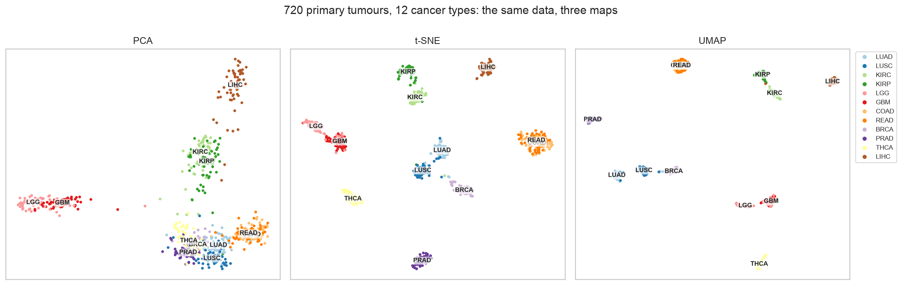

# 03.1 · My Implementation

My own work for [03.1 Intro & Fundamentals](../). There are three notebooks, each written so a reader new to machine
learning can follow it: every section opens with an **"In plain language"** box. For background, start with the
session's [`LESSONS.md`](../LESSONS.md).

| File | What it is |
|------|------------|
| [`01_iris_pipeline_model_comparison.ipynb`](01_iris_pipeline_model_comparison.ipynb) | **Fair model comparison on Iris:** logistic regression, SVM and random forest in `Pipeline`s vs a no-skill baseline; 5×10 repeated stratified CV with paired fold differences; confusion matrix and decision boundaries; a scaling experiment on Wine; the test set used once, with confidence intervals |
| [`02_tcga_dimensionality_reduction.ipynb`](02_tcga_dimensionality_reduction.ipynb) | **PCA vs t-SNE vs UMAP on 720 TCGA tumours of 12 cancer types** (chosen as 4 related pairs + 4 unrelated types), scored for local structure, trustworthiness and global layout; seed stability; perplexity / `n_neighbors` sweeps; a sex-gene confounder check |
| [`03_tcga_clustering_kmeans_vs_hierarchical.ipynb`](03_tcga_clustering_kmeans_vs_hierarchical.ipynb) | **k-means vs hierarchical clustering (Ward / average / complete)** for k = 2–20, scored with silhouette (label-free) and ARI (vs known types); contingency tables; type dendrogram; a test of a tempting but unsupported explanation; two common traps |
| [`figures/`](figures/) | Figures saved by the notebooks (01–04 Iris, 05–08 embeddings, 09–11 clustering) |
| [`../../../src/dsls/expression.py`](../../../src/dsls/expression.py) | **Expression helpers**: TCGA sample-type parsing, balanced subsampling, top-variance gene selection, and two embedding-quality scores (cross-validated kNN label agreement, centroid-distance correlation) |
| [`../../../tests/test_expression.py`](../../../tests/test_expression.py) | 6 unit tests for the helpers (two cover `GeneSelector`, added for the [gene-expression project](../../../05_group_projects/gene_expression/implementation/)) |

## Key results



**Model comparison (Iris)**
- **Logistic regression, SVM and random forest are equivalent**: CV accuracy 0.966 / 0.961 / 0.954, with gaps
  (≤ 1.2 points) far smaller than the fold-to-fold spread (SD about 3.5 points). LR and RF tie on 72 % of folds.
- **The 38-flower test set reverses the ranking** (SVM 36/38, LR 35/38, RF 34/38; 95 % CIs overlap almost
  completely). Rank models with repeated CV, not one small test set.
- **Scaling inside the pipeline** takes SVM from 0.68 to 0.98 and KNN from 0.71 to 0.96 on Wine; the random forest is
  unchanged (0.98).

**Embeddings (TCGA)**
- **t-SNE/UMAP keep neighbourhoods** (kNN label agreement 0.88–0.89, equal to the 50-PC ceiling; trustworthiness
  0.99) but **not the global layout** (ρ 0.55 / 0.42). **PCA is the opposite** (agreement 0.69, ρ 0.95).
- **UMAP's global layout depends on the random seed** (ρ 0.21–0.56 over 10 seeds). **t-SNE with PCA
  initialisation is fully reproducible** and keeps more global structure than random initialisation.
- **Perplexity 5 breaks single cancer types into islands** that aren't real subtypes.
- **Rectal tumours are recognised only 35 % of the time.** They're molecularly almost identical to colon tumours (TCGA
  analysed them together).

**Clustering (TCGA)**
- **k-means ≈ Ward** (ARI 0.82 at k = 12) **> average/complete linkage**.
- **The silhouette picks k = 9, and those clusters are organs**: brain, kidney and colorectal pairs merged, lung split.
  A label-free score finds the strongest structure, not necessarily clinical categories.
- **Merging colon + rectum** raises ARI from 0.82 to **0.94**.
- **Traps measured:** single-start k-means varies from ARI 0.71 to 0.83 by seed; silhouettes computed on a UMAP map
  are about **2× inflated** (0.75–0.77 vs 0.34–0.41 in PC space).

## Design decisions
- **Labels never touch preprocessing.** Gene selection (top variance), scaling and PCA are label-free. Labels are used
  only to *score* the maps and clusters.
- **A benchmark with built-in answers.** Choosing related pairs (lung, kidney, brain, colorectal) makes "did the
  method find real structure?" testable instead of a matter of taste.
- **Balanced classes** (60 per type) so that breast cancer (1,097 primary tumours) doesn't dominate.
- **No story without evidence.** A small mixed cluster at k = 12 had no consistent immune or stromal marker signature
  across types, so it is reported as unexplained.

## Run it
```bash
make setup && make test                  # includes tests/test_expression.py
scripts/fetch_course_materials.sh --data # TCGA data → data/raw/gene_expression/ (~590 MB, only for notebooks 02–03)
make lab                                 # open the notebooks with the "Python 3 (EMBL-EBI DS .venv)" kernel → Run All
```
Notebook 01 needs no download (about 30 s). Notebooks 02 and 03 take about a minute each.

*Data: Iris and Wine ship with scikit-learn. TCGA pan-cancer RNA-seq via UCSC Xena (open access, NIH GDC data-use
policy), as distributed with the course's gene-expression project; raw data is git-ignored.*
