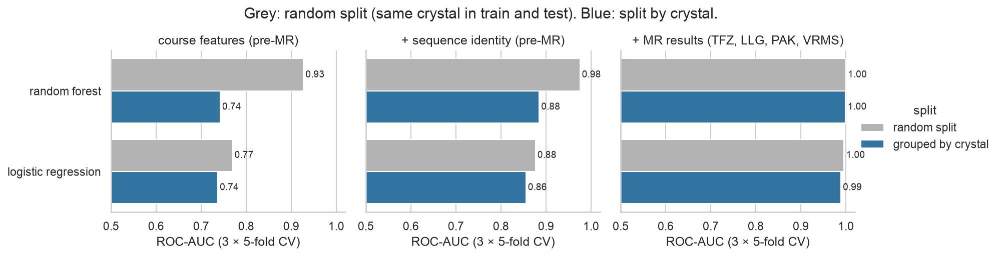

# 03.2 · My Implementation

My own work for [03.2 Hyperparameters & Performance](../), on the course's molecular-replacement (MR) dataset.
Both notebooks explain each step in plain language for readers new to the field. Start with the session's
[`LESSONS.md`](../LESSONS.md) if crystallography or model evaluation is new to you.

| File | What it is |
|------|------------|
| [`01_mr_audit_leakage_nested_cv.ipynb`](01_mr_audit_leakage_nested_cv.ipynb) | **Data audit → which features are allowed → hidden duplicates → leakage experiment → nested, grouped CV of the eight course classifiers** (plus logistic regression and a baseline) in impute → scale → select → model pipelines |
| [`02_mr_imbalance_and_learning_curves.ipynb`](02_mr_imbalance_and_learning_curves.ipynb) | **Class weights vs oversampling vs SMOTE vs undersampling** at the natural balance and in a simulated rare-success scenario; **thresholds vs resampling**; **learning curves**; **validation curves under two splitting schemes** |
| [`figures/`](figures/) | Six figures saved by the notebooks |
| [`../../../src/dsls/mr.py`](../../../src/dsls/mr.py) | Loading and cleaning (thousands separators, CCP4 space-group codes, impossible zeros), feature lists (pre-MR vs MR results), group-aware prevalence subsampling |
| [`../../../tests/test_mr.py`](../../../tests/test_mr.py) | 4 unit tests |

## Key results



**The tutorial's random split overestimates performance.** The 663 rows come from **359 crystals**. All 164 crystals
with several rows have the same outcome in every row, and 79 % of those rows have a sister row as their nearest
neighbour. Splitting by crystal:

| Random forest, course features | Random split | Split by crystal |
|---|---|---|
| ROC-AUC | 0.93 | **0.74** |

Logistic regression barely changes (0.77 → 0.74): it can't memorise individual crystals, so on unseen crystals
the two models are equal.

**Other findings**
- **Target leakage:** the MR results (TFZ, LLG, PAK, VRMS) give AUC ≈ 1.0. Every success has LLG ≥ 62, because
  success is *judged* from these numbers. They are excluded, as in the course.
- **Nested grouped CV:** seven of the eight course classifiers, plus logistic regression, score 0.73–0.76, all within
  noise. Logistic regression is joint best (0.757). Tuning always chose shallow forests (depth 3–5).
- **Domain knowledge beats model choice:** adding **sequence identity**, which is known before MR but unused in the
  course, raises grouped AUC to 0.86–0.88.
- **Imbalance:** at the natural 44 % success rate, no strategy matters (±0.01 AUC). At a simulated 10 %, rebalancing
  raises recall from about 1 % to 42–63 % but **doesn't improve PR-AUC**. **Moving the threshold** of the plain model
  matched undersampling's recall (74 %) with higher precision (37 % vs 30 %).
- **Learning curves:** more data would help the forest slightly and logistic regression hardly at all; better
  features are the better investment.
- **Validation curves depend on the split:** a random split recommends depth 20 (AUC 0.92); a split by crystal
  recommends depth 2 (0.77). **The wrong split picks the wrong model**, not just the wrong score.

## Data audit (fixed in `dsls.mr`)
1. **Numbers stored as text** (`"2,449.00"`) → parsed with `thousands=","`.
2. **Space-group codes 1017/1018/2018** are CCP4 alternative settings of groups 17/18, not quantities → mapped to
   1–230.
3. **`model_res = 0` Å** (20 rows) is impossible → treated as missing and imputed with the training median inside
   the pipeline (not `fillna(0)`).
4. **Near-duplicate columns** (RmergeI/RmeasI, multiplicity/anomalousmulti, RmeasdiffI/RmergediffI; |r| > 0.98) →
   kept for comparability; feature selection is tuned inside the pipeline.

## Run it
```bash
make setup && make test   # includes tests/test_mr.py
make lab                  # open the notebooks with the "Python 3 (EMBL-EBI DS .venv)" kernel → Run All
```
No download needed: the data ships with the course tutorial (MIT licence). Notebook 01 takes about 3 minutes
(nested CV) and notebook 02 about 2 minutes.
