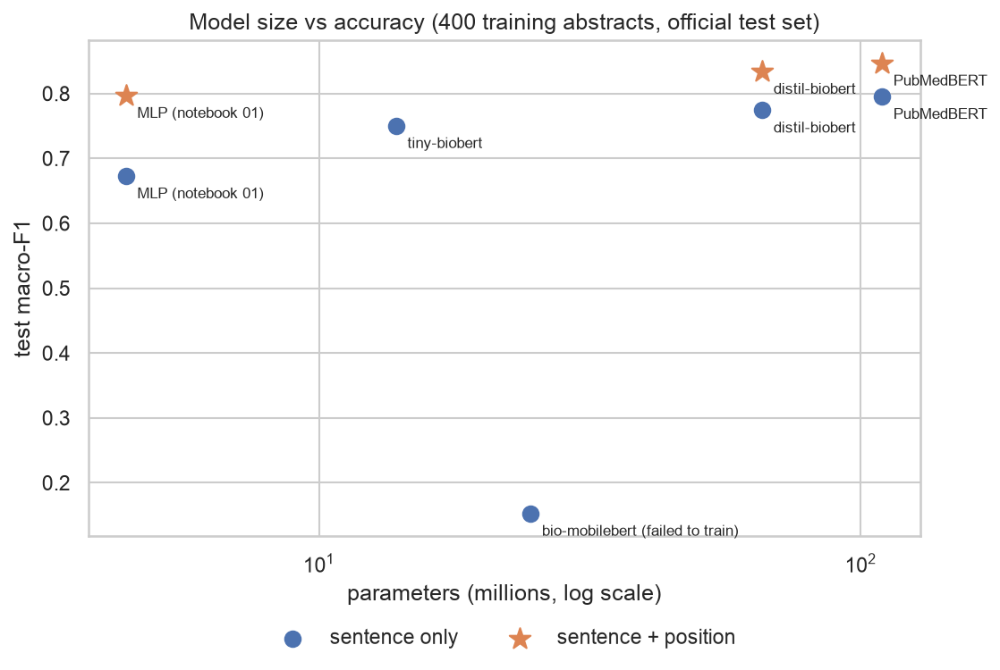
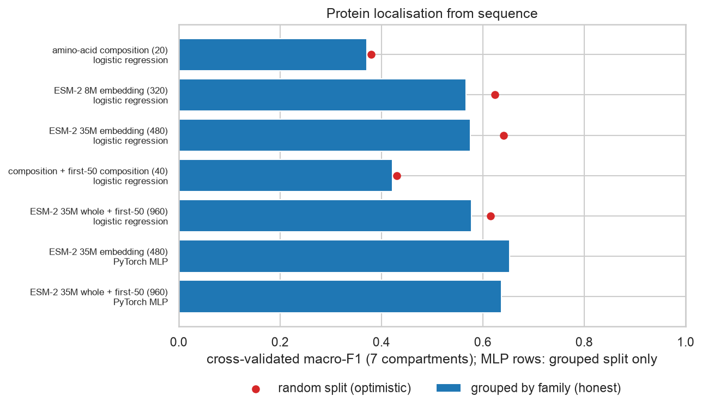

# 04.1 · My Implementation

My own work for [04.1 DNNs & Transformers](../). Every notebook explains each step in plain language for readers new
to the field. Start with the session's [`LESSONS.md`](../LESSONS.md) if neural networks or transformers are new to you.

| File | What it is |
|------|------------|
| [`01_pytorch_mlp_pubmed_rct.ipynb`](01_pytorch_mlp_pubmed_rct.ipynb) | **A neural network built in PyTorch** (data loader, `nn.Module`, early stopping) on PubMed RCT sentence roles. Checks the course's split, explains the course 1A score (stop-word removal × SVD), adds **sentence position** as a feature, and scores the course's own PubMedBERT on the same official test set |
| [`02_small_biomedical_transformers.ipynb`](02_small_biomedical_transformers.ipynb) | **Four biomedical transformers (14–110 M parameters)** fine-tuned with a hand-written loop: tokenizers, accuracy vs training and prediction speed, a failed model diagnosed, **position written into the text**, and why the course run took 3 h 15 min |
| [`03_esm2_protein_localisation.ipynb`](03_esm2_protein_localisation.ipynb) | **Where in the cell does a protein work?** 4,856 human proteins with experimental locations from UniProt; amino-acid composition vs **ESM-2 protein-language-model embeddings**; cross-validation grouped by protein family; the same PyTorch network from notebook 01 |
| [`figures/`](figures/) · [`results/`](results/) | Six figures and the transformer results table, saved by the notebooks |
| [`../../../src/dsls/textclf.py`](../../../src/dsls/textclf.py) | Reusable PyTorch pieces: position features, sparse-aware `DataLoader`, seeded `MLPClassifier`, training loop with early stopping |
| [`../../../src/dsls/protein.py`](../../../src/dsls/protein.py) | UniProt location parsing (experimental evidence only) and amino-acid composition |
| [`../../../tests/test_textclf.py`](../../../tests/test_textclf.py) · [`test_protein.py`](../../../tests/test_protein.py) | 11 unit tests (CPU only, seconds) |

## Key results

### Sentence roles in medical abstracts (official test set: 29,578 sentences from 2,500 unseen abstracts)



| Model | Training data | Macro-F1 | Accuracy | Training time |
|---|---|---|---|---|
| Course 1A: TF-IDF → SVD → MLP (course's own split) | 4,800 sentences | 0.535 | 0.635 | 14 s |
| TF-IDF + logistic regression | 400 abstracts | 0.676 | 0.758 | 1 s |
| My PyTorch MLP + sentence position | 400 abstracts | 0.797 | 0.853 | 23 s |
| tiny-biobert (14 M parameters) | 400 abstracts | 0.750 | 0.817 | 50 s |
| PubMedBERT (110 M), my loop | 400 abstracts | 0.795 | 0.858 | 310 s |
| **PubMedBERT + "sentence 3 of 12:" prefix** | 400 abstracts | **0.847** | **0.899** | 325 s |
| My PyTorch MLP + position, all data | 15,000 abstracts | 0.833 | 0.885 | 179 s |

- **The course's 1A score was mostly preprocessing.** Removing English stop words cost 0.09 macro-F1 and SVD
  compression another 0.03: the small words ("we", "were", "to") are what signal a sentence's role.
- **Sentence position is the most valuable feature:** +0.13 for the MLP, +0.05 for PubMedBERT. Given as text, it makes
  PubMedBERT trained on 400 abstracts beat everything else, including models trained on all 15,000.
- **Small models are often enough:** tiny-biobert came within 0.045 of PubMedBERT, training 6× and predicting 7× faster.
- **The course's 3 h 15 min fine-tune was mostly a stall:** one 9.5-second evaluation took 35 minutes in its log.
- **bio-mobilebert failed** (0.153): its new output layer starts with scores in the tens of thousands. I diagnosed it
  and report it as a failure.
- **Null result:** the course's sentence-level split (same abstracts in train and test) did *not* inflate scores here.

### Protein localisation from sequence (7 compartments, 5-fold CV grouped by protein family)



| Features → model | Grouped macro-F1 | Random-split macro-F1 |
|---|---|---|
| Amino-acid composition → logistic regression | 0.371 | 0.380 |
| + composition of the first 50 residues | 0.422 | 0.430 |
| ESM-2 8M embedding → logistic regression | 0.567 | 0.624 |
| ESM-2 35M embedding → logistic regression | 0.575 | 0.641 |
| **ESM-2 35M embedding → PyTorch MLP** | **0.653** | |

- **A protein language model's embeddings** lift macro-F1 from 0.37 to 0.57 without any fine-tuning; a small network
  on top reaches 0.65.
- **Leaky splits flatter good features most:** +0.07 for ESM-2 embeddings vs +0.01 for composition.
- **Domain knowledge must be measured:** the N-terminal targeting-signal idea helped the crude baseline (+0.05) but
  not ESM-2, which already reads that signal.
- **Hardest compartments:** Golgi (F1 0.32) and endoplasmic reticulum (0.53), which share the secretory route;
  nucleus vs cytoplasm is the most common confusion.

## Run it
```bash
make setup && make test          # includes tests/test_textclf.py and tests/test_protein.py
make lab                         # "Python 3 (EMBL-EBI DS .venv)" kernel → Run All
```
Runtimes on an Apple-silicon laptop (GPU via MPS): notebook 01 about 10 minutes, notebook 02 about 30 minutes,
notebook 03 about 5 minutes the first time and 2 minutes afterwards (embeddings are cached in the git-ignored
`data/interim/`). Notebook 01's last section uses the course's fine-tuned checkpoint if you have run 1B locally
(`make runnable`); otherwise it is skipped.

Data and models are downloaded at run time, never committed: PubMed 20k RCT (`armanc/pubmed-rct20k` on Hugging Face),
UniProtKB/Swiss-Prot ([CC BY 4.0](https://www.uniprot.org/help/license)), and MIT-licensed checkpoints
(PubMedBERT, nlpie/tiny-biobert, nlpie/bio-mobilebert, nlpie/distil-biobert, ESM-2).

**Reproducibility:** results that run on the CPU (notebook 03's network, all scikit-learn models) are exactly
repeatable. GPU (MPS) arithmetic isn't bit-for-bit deterministic, so GPU-trained scores can move by about ±0.002
between runs, and timings depend on what else the machine is doing.
