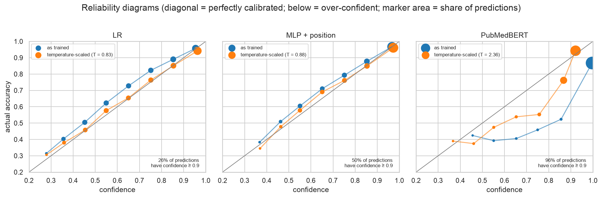
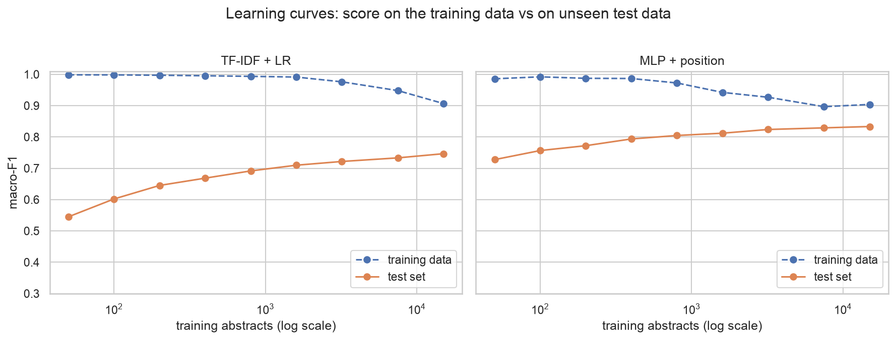

# 04.2 · My Implementation

My own work for [04.2 Evaluation & Visualisation](../), using the PubMed RCT sentence classifiers from
[04.1](../../01_dnn_and_transformers/implementation/). Both notebooks explain each step in plain language for readers
new to the field. Start with the session's [`LESSONS.md`](../LESSONS.md) if metrics or calibration are new to you.

| File | What it is |
|------|------------|
| [`01_uncertainty_calibration_errors.ipynb`](01_uncertainty_calibration_errors.ipynb) | Three models (logistic regression, my PyTorch MLP + position, the course's PubMedBERT) on the official test set: **per-class metrics, bootstrap intervals and paired comparisons, confusion and agreement analysis, reliability diagrams and temperature scaling, confidence-based triage, a calibrated ensemble, and the most confident errors** |
| [`02_duplicates_label_noise_learning_curves.ipynb`](02_duplicates_label_noise_learning_curves.ipynb) | **Leakage check:** exact and near-duplicate sentences across the official splits and their effect on scores; **inconsistent labels**; **learning curves** from 50 to 15,000 training abstracts |
| [`figures/`](figures/) | Six figures saved by the notebooks |
| [`../../../src/dsls/evaluation.py`](../../../src/dsls/evaluation.py) | Reusable evaluation: per-class report, (grouped, paired) bootstrap from confusion matrices, reliability table, ECE, temperature scaling, coverage curve, text normalisation and nearest-neighbour duplicate search |
| [`../../../tests/test_evaluation.py`](../../../tests/test_evaluation.py) | 12 unit tests, checked against scikit-learn where it has an equivalent |

## Key results



| | LR | MLP + position | PubMedBERT (course) |
|---|---|---|---|
| accuracy | 0.758 | 0.853 | 0.850 |
| macro-F1 (95 % interval, resampling abstracts) | 0.676 (0.668–0.683) | **0.797** (0.790–0.804) | 0.782 (0.775–0.788) |
| average confidence | 0.714 | 0.832 | **0.985** |
| calibration error (ECE) → after temperature scaling | 0.045 → 0.014 | 0.021 → 0.014 | **0.135 → 0.056** |
| accuracy on its most confident 30 % | 0.951 | **0.980** | 0.961 |

- **Accuracy called it a tie; macro-F1 and a paired bootstrap didn't.** The MLP leads PubMedBERT by +0.015 macro-F1
  (95 % interval +0.009 to +0.022). PubMedBERT is better on *methods* and *results*, the MLP on the positional classes
  (*background*, *conclusions*). *Objective* defeats all three (F1 0.55–0.60).
- **PubMedBERT is over-confident:** "≥ 90 % sure" on 96 % of sentences while right on 85 %. Temperature scaling
  (T = 2.36) helps but can't fix the shape; the two regularised models were nearly calibrated from the start.
- **The models fail on different sentences.** Averaging the calibrated MLP and PubMedBERT gives macro-F1 0.814
  (+0.033 over PubMedBERT).
- **The most confident "errors" are mostly label noise:** results-like sentences that authors placed under
  *Conclusions* or *Methods*, including one that begins "RESULST :".
- **No leakage from duplicates:** 1.4 % of test sentences have an exact copy in training, all stock phrases from
  different papers. Removing every exact and near copy changes accuracy by −0.002.
- **Labels have a ceiling:** 75 training sentences carry more than one label.
- **Learning curves:** the MLP flattens near 0.83 with a small train–test gap, so more data has little left to give.
  With position features, **100 abstracts beat logistic regression trained on 15,000**.



## Run it
```bash
make setup && make test   # includes tests/test_evaluation.py
make lab                  # "Python 3 (EMBL-EBI DS .venv)" kernel → Run All
```
Runtimes on an Apple-silicon laptop: notebook 01 about 5 minutes, notebook 02 about 18 minutes. Notebook 01's
PubMedBERT sections need the course's 1B checkpoint (`make runnable`, then run 1B in 04.1); without it, the notebook
runs with the other two models. The data (PubMed 20k RCT) is downloaded from Hugging Face at run time.

**Experiment tracking:** the course demonstrates Weights & Biases, which needs an account. I didn't use it here.
Instead, every run is reproducible from the notebook: fixed seeds, versions printed, and results computed from the
saved notebooks.
