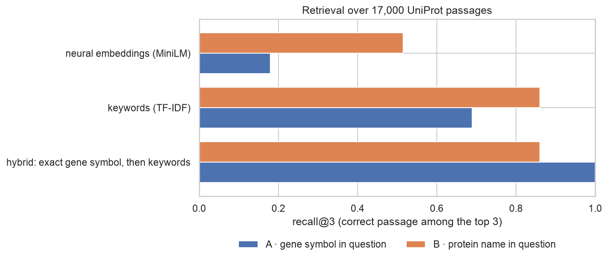

# 04.3 · My Implementation

My own work for [04.3 Intro to LLMs](../). Both notebooks use small, openly licensed models that run on a laptop, and
explain each step in plain language for readers new to the field. Start with the session's
[`LESSONS.md`](../LESSONS.md) if tokens, hallucination or RAG are new to you.

| File | What it is |
|------|------------|
| [`01_tokens_genes_dna_proteins.ipynb`](01_tokens_genes_dna_proteins.ipynb) | **What an LLM sees:** next-token probabilities and temperature in Qwen2.5-0.5B-Instruct; how six tokenisers split all 20,188 human gene symbols; DNA and protein sequences through text and protein tokenisers; can the model count letters? |
| [`02_rag_over_uniprot.ipynb`](02_rag_over_uniprot.ipynb) | **A minimal RAG system over 17,346 UniProt entries, graded:** keyword vs neural vs hybrid retrieval; closed-book vs RAG on 200 questions with known answers; failure analysis and a prompt ablation; made-up genes with a real-gene control; checking where answers came from |
| [`figures/`](figures/) | Two figures saved by the notebooks |
| [`../../../src/dsls/rag.py`](../../../src/dsls/rag.py) | Reusable RAG pieces (no LLM inside): UniProt passages, hybrid search with exact-identifier boost, the cite-or-abstain prompt, abstention and citation checks, evidence overlap |
| [`../../../tests/test_rag.py`](../../../tests/test_rag.py) | 5 unit tests |

## Key results

**Tokens (notebook 01)**
- **General tokenisers shred gene symbols:** GPT-2, BERT and Qwen2.5 keep only 0.3–0.5 % of 20,188 symbols as one
  token. PubMedBERT keeps 2.7 % whole overall but 52 % of the 200 most-mentioned genes, because its vocabulary came from
  PubMed.
- **BERT-style tokenisers turn a whole DNA or protein sequence into one `[UNK]`**, with no warning; the ESM-2 protein
  model silently accepts DNA as if it were protein.
- Qwen2.5-0.5B counted the Gs in short DNA strings correctly 5–8 % of the time. Exact operations belong in code.

**RAG (notebook 02)**



| 100 questions per test | Closed-book | RAG (top 3 passages) | Right passage retrieved |
|---|---|---|---|
| A · UniProt accession of gene *X* | 0 % | **82 %** | 100 % |
| B · gene encoding protein *Y* | 8 % | **63 %** | 86 % |
| 20 made-up genes: says "not found" | 1 genuine refusal (+5 off-topic ones) | **20 of 20** | — |
| 20 real genes: wrongly says "not found" | 0 | **0 of 20** | — |

- **Neural embeddings failed on identifiers** (right entry in top 3 for 18 % of gene-symbol questions) because the
  tokeniser splits symbols into fragments. An exact-match rule reached 100 %.
- **Most remaining errors were caused by my prompt:** 17 of 18 test A errors were *P04637*, the example accession in
  the instructions. Removing the example made the model answer "1" (the passage number) instead; removing the
  citation rule fixed test A (100 %) but hurt test B (51 %). One sentence of wording moved accuracy by up to 18 points.
- **The model never cited its source**, but every free-text answer could be traced to the correct entry by word
  overlap (8 of 8). Attaching sources is the system's job, not the model's.

## Run it
```bash
make setup && make test   # includes tests/test_rag.py
make lab                  # "Python 3 (EMBL-EBI DS .venv)" kernel → Run All
```
Runtimes on an Apple-silicon laptop: notebook 01 about 3 minutes, notebook 02 about 8 minutes. The models
(Qwen2.5-0.5B-Instruct, all-MiniLM-L6-v2, tokenisers: all MIT or Apache-2.0) are downloaded from Hugging Face on first
run; UniProt entries are fetched through the cached EBI client. Nothing downloaded is committed.

**Models I chose not to use:** DNABERT-2 and GROVER (no licence stated on the model card), Nucleotide Transformer
(non-commercial licence), HyenaDNA (requires running remote code).
