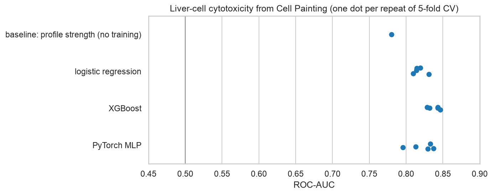
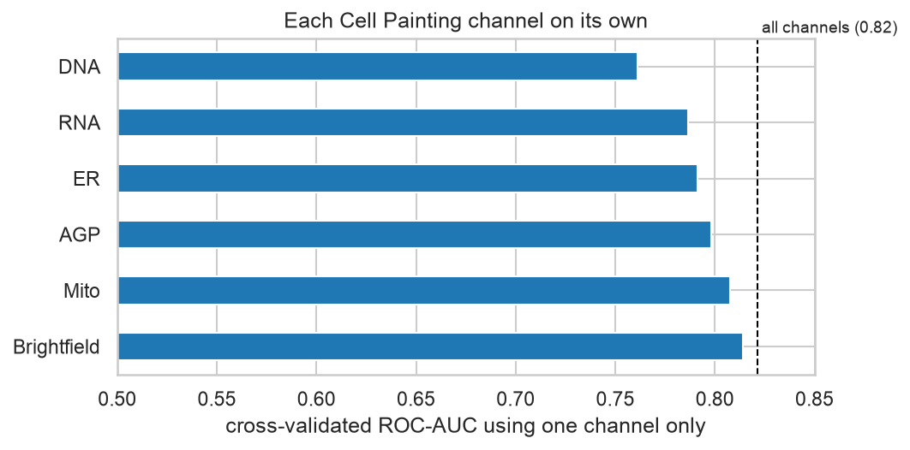

# Bioimaging project · My Implementation

My own work for the [bioimaging project](../): can Cell Painting morphology profiles predict chemical toxicity?
The notebook explains each step in plain language; start with the project's [`LESSONS.md`](../LESSONS.md) if
morphological profiling or imbalanced evaluation is new to you.

| File | What it is |
|------|------------|
| [`01_cytotoxicity_from_cell_painting.ipynb`](01_cytotoxicity_from_cell_painting.ipynb) | **Liver-cell cytotoxicity from morphology profiles:** endpoint choice and linking checks; a no-training baseline; logistic regression vs XGBoost vs a PyTorch MLP on **identical compound-aware splits** with paired comparisons; per-channel and leave-one-channel-out analysis; error analysis |
| [`figures/`](figures/) | Model comparison and per-channel figures |

## Key results



548 compounds (24 % toxic), 4,434 features, 5-fold cross-validation grouped by molecule, 5 repeats:

| | ROC-AUC | PR-AUC (chance 0.24) |
|---|---|---|
| **baseline: overall profile strength, no training** | 0.780 | 0.541 |
| logistic regression | 0.818 | 0.640 |
| XGBoost | **0.839** | 0.640 |
| PyTorch MLP | 0.822 | 0.640 |

- **The no-training baseline reaches 0.78.** Simply asking "how much did this compound change the cells" ranks
  toxic compounds well, so most of the apparent accuracy is not specific learning. Models add a real but modest
  amount (+0.10 PR-AUC).
- **The metric decides the winner.** XGBoost leads on ROC-AUC in all 5 repeats, but all three models tie on PR-AUC
  (0.640), which is what matters when you can only test the top of the list.
- **The neural network did not beat logistic regression** (+0.004) and varied most between repeats: 548 compounds
  is too few for its flexibility, while costing 30× XGBoost's runtime to be no better.
- **No single Cell Painting channel is essential:** each alone reaches ROC-AUC 0.76–0.81 and removing any costs
  ≤ 0.01. **Brightfield** (the unstained image) does as well as the dyes for this endpoint.
- **Linking is lossy:** only 791 of 1,086 profiled compounds match the identifier table by name.



## Run it
```bash
scripts/fetch_course_materials.sh --data   # profiles and ToxCast labels → data/raw/bioimaging/ (git-ignored)
make setup-course && make test
make lab   # "Python 3 (EMBL-EBI DS .venv)" kernel → Run All
```
Runtime about 8 minutes on an Apple-silicon laptop (XGBoost is most of it).
