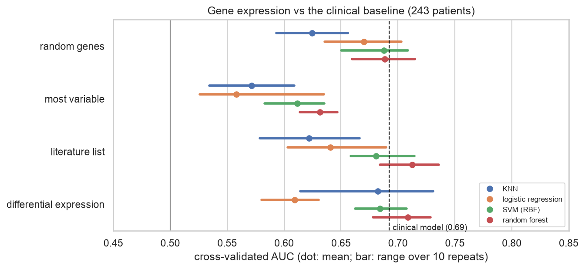
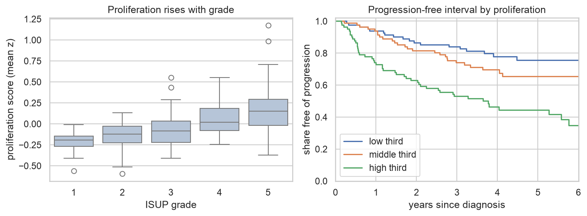

# Gene-expression project · My Implementation

My own work for the [gene-expression project](../): can tumour gene expression predict prostate-cancer recurrence
(TCGA PRAD, 243 patients × 20,174 genes)? Both notebooks explain each step in plain language; start with the
project's [`LESSONS.md`](../LESSONS.md) if *p ≫ n*, leakage or survival analysis are new to you. The pan-cancer
clustering part of the project is covered in [module 03.1](../../../03_foundations_of_machine_learning/01_intro_and_fundamentals/implementation/).

| File | What it is |
|------|------------|
| [`01_recurrence_honest_evaluation.ipynb`](01_recurrence_honest_evaluation.ipynb) | **3-year recurrence, evaluated honestly:** clinical baseline; leaky vs honest gene selection, with a shuffled-label test; 4 gene sets × 4 classifiers on the same 50 splits; nested cross-validation of expression-only and clinical + expression models with a paired bootstrap; the spread of single-split test scores; stability of the selected genes |
| [`02_survival_and_pathways.ipynb`](02_survival_and_pathways.ipynb) | **Time to progression:** Kaplan–Meier curves and log-rank test by grade; a predefined Reactome proliferation score with a random-gene-set control; Cox models and cross-validated concordance; Reactome pathway over-representation |
| [`figures/`](figures/) · [`results/`](results/) | Four figures; the stable genes and the Reactome enrichment tables |
| [`../../../src/dsls/expression.py`](../../../src/dsls/expression.py) | `GeneSelector`: a scikit-learn step that selects genes (differential expression, variance, fixed list, random) on the training fold only |
| [`../../../src/dsls/survival.py`](../../../src/dsls/survival.py) | Harrell's concordance index and a label-free gene-set score |
| [`../../../src/dsls/ebi_api.py`](../../../src/dsls/ebi_api.py) | Now with cached POST requests and a `reactome()` client for pathway analysis |

## Key results



| Cross-validated | AUC (3-year recurrence) | C-index (time to progression) |
|---|---|---|
| ISUP grade alone | 0.694 | 0.683 |
| clinical (grade + T stage + PSA) | 0.690 | 0.676 |
| expression only (nested CV, tuned) | 0.694 | — |
| proliferation score only | — | 0.655 |
| clinical + expression / + proliferation | 0.713 | 0.690 |

- **The pathologist's grade is the bar to beat, and expression doesn't clearly clear it.** Adding expression to the
  clinical model changes AUC by +0.034, 95 % interval −0.044 to +0.111.
- **Leakage is the biggest effect in the project:** selecting genes before cross-validation turned **shuffled
  labels** into AUC 0.744; selection inside each fold correctly gave 0.478.
- **Random genes did as well as selected ones**, and the most variable genes did worst: the signal is broad.
- **One 73-patient test set is a lottery:** the same model's test AUC spans 0.52–0.72 across 200 random splits,
  wider than the differences the course's single split was used to rank.
- **The signal is largely proliferation, which the grade already captures.** A predefined mitotic gene score from
  Reactome predicts progression (HR 1.68 per SD) and beats 98 % of random gene sets, but next to the grade its HR
  falls to 1.24 (p = 0.07). Reactome independently finds **cell-cycle, mitotic-checkpoint and DNA-repair pathways**
  among genes higher in progressing tumours.



## Run it
```bash
scripts/fetch_course_materials.sh --data   # TCGA files → data/raw/gene_expression/ (git-ignored)
make setup-course && make test              # pyreadr and statsmodels come with the course extras
make lab                                    # "Python 3 (EMBL-EBI DS .venv)" kernel → Run All
```
Runtimes on an Apple-silicon laptop: notebook 01 about 12 minutes (mostly nested cross-validation), notebook 02
under a minute. Reactome responses are cached in `data/raw/api_cache/`, so re-runs work offline.
