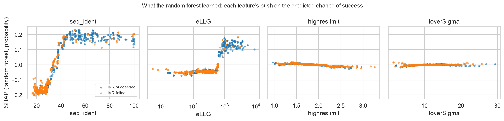

# Structural-biology project · My Implementation

My own work for the [structural-biology project](../). Start with the project's [`LESSONS.md`](../LESSONS.md) if
crystallography or model interpretation is new to you.

| File | What it is |
|------|------------|
| [`01_mr_success_shap.ipynb`](01_mr_success_shap.ipynb) | **Part 1: what makes molecular replacement succeed?** Out-of-fold SHAP for logistic regression and a random forest on crystals the models never saw; stability across 25 training sets; feature families for correlated statistics; a stratified check and ablation showing the anomalous signal is a proxy; dependence shapes; error analysis |
| [`figures/`](figures/) | SHAP summary and dependence figures |

The data audit, grouped nested cross-validation, imbalance and learning-curve work for Part 1 is in
[module 03.2](../../../03_foundations_of_machine_learning/02_hyperparameters_and_performance/implementation/).

## Key results (Part 1)



| Grouped 5-fold CV, 5 repeats | Logistic regression | Random forest |
|---|---|---|
| all 28 pre-MR features | 0.857 | 0.879 |
| without the 9 anomalous-signal features | 0.856 | 0.875 |
| **3 search-model features only** | **0.874** | **0.885** |

- **The search model decides.** Sequence identity ranks first in all 25 folds for both models; the forest learned
  the crystallographers' rule of thumb from the data (its push turns positive at 33–37 % identity, strongly negative
  below 30 %).
- **The data-quality statistics add almost nothing** once the search model is known; resolution and I/σ move
  predictions by less than ±0.02.
- **The anomalous signal is a proxy for study design:** weak-anomalous datasets have median identity 54 % vs 28–30 %
  for the rest (no anomalous data needed when a close homologue exists). Within identity bands the link mostly
  disappears, and removing the whole family costs ≤ 0.004 AUC.
- **Explanations need checks:** the two models agree on the top two features but only weakly overall (rank
  agreement 0.27), and one impossible value (a 73 Å model resolution) distorted the linear model's explanation until
  it was treated as missing.

## Part 2 (crystal images)
Not started yet. The AXIS/CRIMS image sets on Zenodo (8 GB) are licensed **CC BY-NC 4.0** (non-commercial), so how
they are used here is decided before downloading.

## Run it
```bash
make setup-course && make test
make lab   # "Python 3 (EMBL-EBI DS .venv)" kernel → Run All
```
No download needed: the MR data ship with the course tutorial (MIT licence). Runtime about 1 minute.
